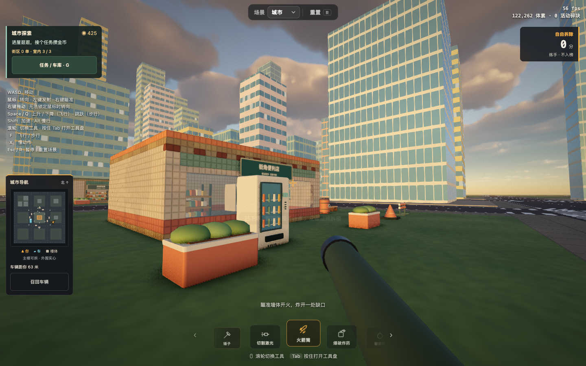

# 拆楼实验室 · 解压小游戏

[在线试玩](https://voxel-demolition-vanche.vercel.app) · [中文操作说明](PLAY.md)



先开车兜一圈，撞开街边物件，再下车用切割、爆破和慢动作拆楼。中文界面，匿名随机/自定义昵称；自由拆除随时重建，90 秒挑战按每个首次拆下的方块计 1 分，结算后上传个人最高分到共享排行榜。

城市版默认步行，在身边的车辆按 **F** 上车；**WASD** 驾驶、**Space** 手刹、**B** 加速，停车后按 **F** 下车。手机使用摇杆、刹车和地图旁的上下车按钮。小地图显示你、车辆和楼体；离车后可以召回车辆。中央主楼和街边体素物件可拆，新增便利店、双层住宅和仓库可进入、可破坏；其余外围楼体提供实心碰撞。驾驶碰撞同样进入原有拆除积分，排行榜规则不变。

v0.4 加入 **三种可驾驶车辆、随机委托、金币车库和进度存档**。按 **G** 打开委托与车库：兜风路线、快递取送地点和清理区域随委托变化，完成一次结算一次金币；已购车辆可免费切换，在安全停车位交车。海风轿车免费，落日皮卡 300 金币，薄荷货车 650 金币，车身、速度和操控各有区别。

v0.5 加入 **便利店、双层住宅、仓库、13 件可拆家具和室内任务**。从真实门洞进入，住宅沿木楼梯上下楼；拆掉家具脚下的楼板，家具也会落下。按 G 选择「进屋任务」：便利店取件 110 金币、二楼找包裹 150 金币、仓库拆旧家具 165 金币，返回门口结算，每项奖励一次。

v0.6 加入 **54 件可破坏街区道具与 10 个连锁爆炸容器**。出生点附近维修区、便利店补货区、仓库装卸区和住宅花园有燃油桶、气瓶、木箱、托盘、路障、锥筒、垃圾箱、饮料机和花箱。桶身筋圈、瓶口阀门、木板与钉子、盖子把手及室内家具改用细化模型；受损时显露真正可碎裂的体素残体。燃油容器受损后延迟引爆，增加冲击环、飞散金属/木片和逐渐消退的地面焦痕。原有金币、室内任务和 v0.5 建筑损坏保留。参考与实现边界见 [街区道具与爆炸](docs/urban-props.md)。

工具栏也加入 **AK47**：按住左键连射，30 发弹匣，打空自动换弹；**V** 或屏幕「换弹」按钮可提前换弹。木托、弯弹匣、枪口闪光、后坐与换弹动作均为本项目编写。子弹会拆掉真实方块并引爆燃油容器，暂停或收起枪时换弹进度冻结；R 仍然重建街区。

v0.7 加入 **3 星通缉、两辆警车和可下车追踪的警员**。开枪、爆炸和撞击会引来追逐；躲开视线后进入搜索，进西侧实体车库躲满 3 秒可以解除通缉。被截停回车库重试，金币与建筑损坏保留。G 菜单的「追逐任务」提供仓库取件、拆开西墙步行脱身、驾车回家，首次奖励 240 金币；可以关闭警察自由拆除。详见 [警察与仓库脱身](docs/police-pursuit.md)。

金币、已购车辆、任务阶段、位置、车况及建筑损坏自动保存在本浏览器。刷新保留破洞与已拆家具，清理散落的动态碎屑；R 重建修复街区，保留金币和普通任务进度；通缉清除，未完成的仓库脱身从取件重试。更换浏览器或清除站点数据会丢失本地存档。金币与 90 秒拆除排行榜分别计算，挑战期间暂停委托和车库。旧版街区徽章自动保留。

街上有 **8 辆自动巡游车辆和 14 位散步路人**。车流按路口信号停车、跟车并避让过街行人；路人有步态动画，会避开靠近的车辆与爆炸。绿色地面标记和地图菱形显示委托的下一站。

暖色城市加入奶油/珊瑚/鼠尾草色立面、蓝绿玻璃、沿街店面和条纹遮篷、16 棵棕榈与公园咖啡桌，默认黄金时段光照。三栋室内建筑沿用奶油墙面、珊瑚砖裙、鼠尾草遮篷与木质家具；真实体素墙体、楼板和门窗全部使用现有破坏系统。新增模型由本项目编写，共享几何与材质，没有复制 ocean-drive 的模型或动画素材。

开放城市方向参考了 [gta7](https://github.com/depixeled-chris/gta7)、[Sketchbook](https://github.com/swift502/Sketchbook) 和 [ocean-drive](https://github.com/StarKnightt/ocean-drive) 的功能组织与车辆交互思路；本次复用自己的 Car/Player、WebGPU 和体素物理，没有导入其他项目的代码或模型。源码依据、版本和后续范围见 [开放城市参考](docs/open-city-references.md)。

本项目基于 [sbobyn/three-voxel-destruction](https://github.com/sbobyn/three-voxel-destruction) 的 MIT 开源实现，保留原作者代码、许可证与资产来源。下方保留原项目玩法和技术介绍。画面细化借鉴 [Bruno Simon 的 folio-2025](https://github.com/brunosimon/folio-2025) 的模型轮廓、色板与光照思路；新增道具细节由本项目编写，未直接复制其模型或贴图。

第一版细化长椅、垃圾桶和消防栓的木条、扶手、螺栓、筋条与阀盖，保持原体素碰撞与积分。新增装饰在对应物体受损后隐藏，重建时恢复；没有复制整个作品集地图。参考分析见 [画面方向与源码依据](docs/visual-direction.md)。

## 本地开发

```sh
npm ci
npm run dev
npm run typecheck
npm test
npm run build
```

开发地址为 http://127.0.0.1:5189 。需要 WebGPU 浏览器。排行榜在服务端运行，配置 `.env.local` 的 `KV_REST_API_URL`、`KV_REST_API_TOKEN` 后，另一个终端运行 `node --env-file=.env.local --experimental-transform-types scripts/local-api.ts`，开发服务器会代理 `/api` 到 5190 端口。也支持 Upstash 的 `UPSTASH_REDIS_REST_URL`、`UPSTASH_REDIS_REST_TOKEN`。不要把这些值放入 `VITE_*` 环境变量。

Vercel 使用 `vercel.json` 的构建配置；为项目连接专用 Upstash Redis，并注入服务端环境变量即可使用云端排行榜。仓库不包含凭证、浏览器身份或试玩成绩。

---

# 原项目：three-voxel-destruction

A Teardown-inspired voxel destruction demo in Three.js (WebGPU): every voxel a body in
[three-avbd](https://github.com/sbobyn/three-avbd)'s GPU rigid-body solver. Three scenes, picked
from the bar at the top:

- **City**: a city block of 94,000 voxels. Hammer it, cut it with a laser, blow it up with
  rockets and charges, or throw a wrecking ball. Storeys give way when what carries them is cut,
  glass shatters, and rubble settles and freezes.
- **Race track** (`?scene=track`): a supercar on a circuit whose walls, stands and tyre stacks
  are all voxels. Drive through them, drift it on the handbrake, fire its rockets and machine
  guns; it takes damage where it's hit and, wrecked, goes up.
- **Space station** (`?scene=space`): a station in orbit with no gravity, over an Earth with
  volumetric clouds. Cut a solar wing loose and it drifts off; blow a module apart and it
  scatters into the dark.

**Play it: [three-voxel-destruction.vercel.app](https://three-voxel-destruction.vercel.app)**


Needs a browser with WebGPU: Chrome or Edge, or Safari on iOS 26 and macOS 26. It runs on
phones and tablets too, with thumb sticks. On the first load of each scene it times your GPU
and picks the quality and how many loose pieces the physics carries, so a collapse holds 60 fps
(Graphics in the menu overrides it; Re-tune measures again).

## Controls

| | |
|---|---|
| Mouse | look; left click uses the tool, right click aims |
| WASD | move; Space / E up, Q / C down (flying), Shift fast, Alt slow |
| Scroll, or hold Tab | switch tools: hammer, laser, rocket, charge, wrecking ball |
| F | enter/exit the nearby car; otherwise fly or walk (walking: Space jumps, C crouches, Shift sprints) |
| X | slow motion |
| T, R | time of day, reset the scene |
| Esc | menu (sensitivity, field of view, graphics, sound) |

In the car (city and race track):

| | |
|---|---|
| W / S | throttle; brake, then reverse |
| A / D | steer |
| Space | handbrake |
| B | boost |
| Left / right click | rockets / machine guns |
| F | get out (and back in, by the car) |

## Running it

```sh
npm ci
npm run dev    # http://127.0.0.1:5189
npm run check  # typecheck, tests (GPU ones through Dawn), build
```

Needs a browser with WebGPU. The labs, `sky-lab.html` and `particles-lab.html`, tune the sky
and the particles on their own.

## three-avbd

It uses the solver through `three-avbd/advanced` (`GpuSolver3D` and the buffer layouts), since
it runs its own compute pass over the bodies (blasts). It depends on the published package
(`three-avbd` on npm). To work on both at once, link a checkout: `pnpm link ../three-avbd`
(after `pnpm build:lib` there).

The city is z-up (the solver's `up` is set to `REF_UP`).

## Credits and license

Textures and skies: [Poly Haven](https://polyhaven.com), CC0 (see `public/textures/CREDITS.md`
and `public/hdri/CREDITS.md`). The Earth: NASA's Blue Marble, public domain
(`public/space/CREDITS.md`); its clouds are procedural, the volumetric cloud layer from
web-gpu-gems (`src/clouds`). The code is MIT (`LICENSE`).
