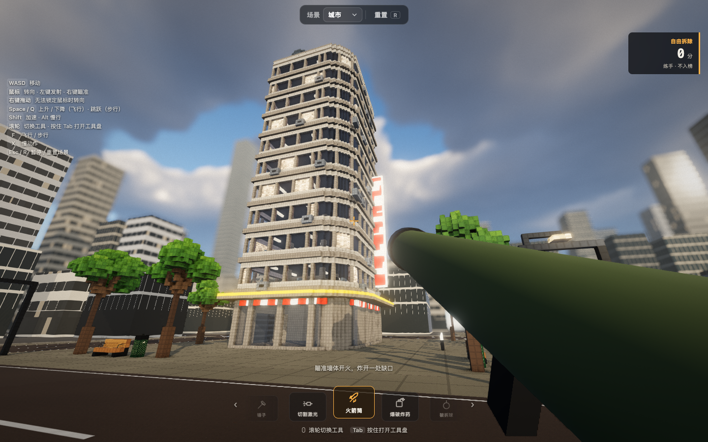

# 拆楼实验室 · 解压小游戏

[在线试玩](https://voxel-demolition-vanche.vercel.app) · [中文操作说明](PLAY.md)



在一座可以拆掉的小街区里，用切割、爆破和慢动作释放压力。中文界面，匿名随机/自定义昵称；自由拆除随时重建，90 秒挑战按每个首次拆下的方块计 1 分，结算后上传个人最高分到共享排行榜。

本项目基于 [sbobyn/three-voxel-destruction](https://github.com/sbobyn/three-voxel-destruction) 的 MIT 开源实现，保留原作者代码、许可证与资产来源。下方保留原项目玩法和技术介绍。画面细化借鉴 [Bruno Simon 的 folio-2025](https://github.com/brunosimon/folio-2025) 的模型轮廓、色板与光照思路；新增道具细节由本项目编写，未直接复制其模型或贴图。

第一版细化长椅、垃圾桶和消防栓的木条、扶手、螺栓、筋条与阀盖，保持原体素碰撞与积分。新增装饰在对应物体受损后隐藏，重建时恢复；没有复制整个作品集地图。参考分析见 [画面方向与源码依据](docs/visual-direction.md)。

## 本地开发

```sh
npm ci
npm run dev
npm run typecheck
npm test
npm run build
```

开发地址为 http://127.0.0.1:5189 。需要 WebGPU 浏览器。排行榜在服务端运行，配置 `.env.local` 的 `KV_REST_API_URL`、`KV_REST_API_TOKEN` 后，另一个终端运行 `node --env-file=.env.local --experimental-transform-types scripts/local-api.ts`，开发服务器会代理 `/api` 到 5190 端口。也支持 Upstash 的 `UPSTASH_REDIS_REST_URL`、`UPSTASH_REDIS_REST_TOKEN`。不要把这些值放入 `VITE_*` 环境变量。

Vercel 使用 `vercel.json` 的构建配置；为项目连接专用 Upstash Redis，并注入服务端环境变量即可使用云端排行榜。仓库不包含凭证、浏览器身份或试玩成绩。

---

# 原项目：three-voxel-destruction

A Teardown-inspired voxel destruction demo in Three.js (WebGPU): every voxel a body in
[three-avbd](https://github.com/sbobyn/three-avbd)'s GPU rigid-body solver. Three scenes, picked
from the bar at the top:

- **City**: a city block of 94,000 voxels. Hammer it, cut it with a laser, blow it up with
  rockets and charges, or throw a wrecking ball. Storeys give way when what carries them is cut,
  glass shatters, and rubble settles and freezes.
- **Race track** (`?scene=track`): a supercar on a circuit whose walls, stands and tyre stacks
  are all voxels. Drive through them, drift it on the handbrake, fire its rockets and machine
  guns; it takes damage where it's hit and, wrecked, goes up.
- **Space station** (`?scene=space`): a station in orbit with no gravity, over an Earth with
  volumetric clouds. Cut a solar wing loose and it drifts off; blow a module apart and it
  scatters into the dark.

**Play it: [three-voxel-destruction.vercel.app](https://three-voxel-destruction.vercel.app)**


Needs a browser with WebGPU: Chrome or Edge, or Safari on iOS 26 and macOS 26. It runs on
phones and tablets too, with thumb sticks. On the first load of each scene it times your GPU
and picks the quality and how many loose pieces the physics carries, so a collapse holds 60 fps
(Graphics in the menu overrides it; Re-tune measures again).

## Controls

| | |
|---|---|
| Mouse | look; left click uses the tool, right click aims |
| WASD | move; Space / E up, Q / C down (flying), Shift fast, Alt slow |
| Scroll, or hold Tab | switch tools: hammer, laser, rocket, charge, wrecking ball |
| F | fly or walk (walking: Space jumps, C crouches, Shift sprints) |
| X | slow motion |
| T, R | time of day, reset the scene |
| Esc | menu (sensitivity, field of view, graphics, sound) |

In the car (the race track):

| | |
|---|---|
| W / S | throttle; brake, then reverse |
| A / D | steer |
| Space | handbrake |
| B | boost |
| Left / right click | rockets / machine guns |
| F | get out (and back in, by the car) |

## Running it

```sh
npm ci
npm run dev    # http://127.0.0.1:5189
npm run check  # typecheck, tests (GPU ones through Dawn), build
```

Needs a browser with WebGPU. The labs, `sky-lab.html` and `particles-lab.html`, tune the sky
and the particles on their own.

## three-avbd

It uses the solver through `three-avbd/advanced` (`GpuSolver3D` and the buffer layouts), since
it runs its own compute pass over the bodies (blasts). It depends on the published package
(`three-avbd` on npm). To work on both at once, link a checkout: `pnpm link ../three-avbd`
(after `pnpm build:lib` there).

The city is z-up (the solver's `up` is set to `REF_UP`).

## Credits and license

Textures and skies: [Poly Haven](https://polyhaven.com), CC0 (see `public/textures/CREDITS.md`
and `public/hdri/CREDITS.md`). The Earth: NASA's Blue Marble, public domain
(`public/space/CREDITS.md`); its clouds are procedural, the volumetric cloud layer from
web-gpu-gems (`src/clouds`). The code is MIT (`LICENSE`).
